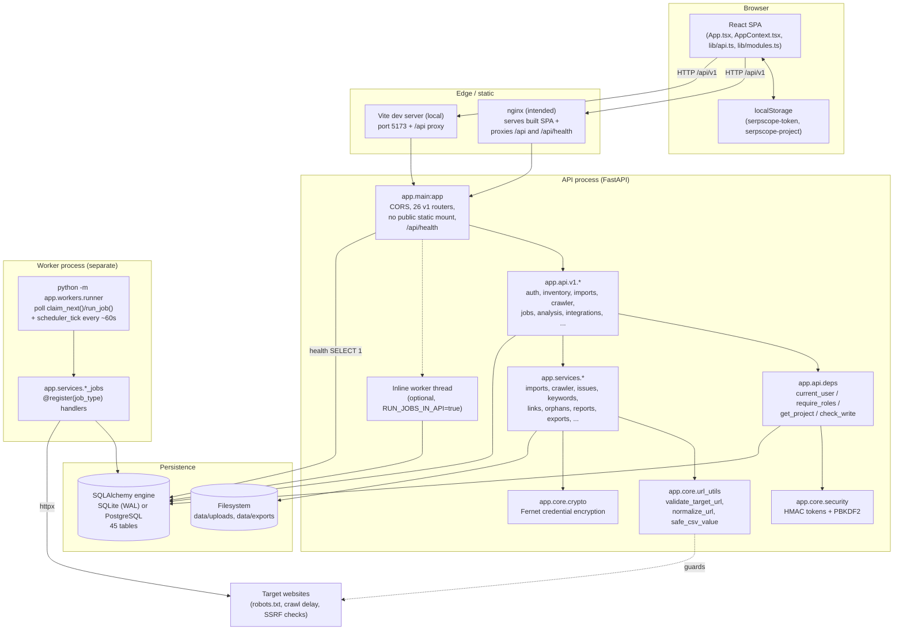
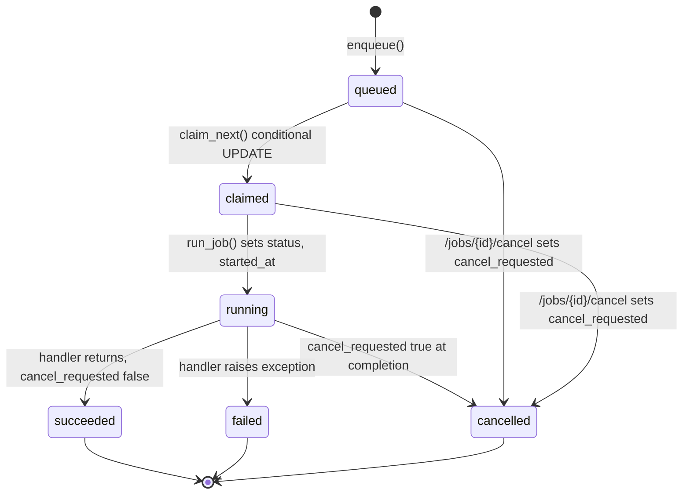
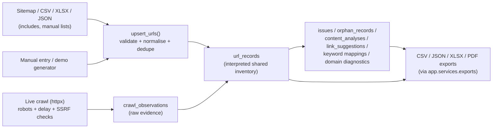

# Architecture

This document describes the implemented architecture of the **SERPScope**: a FastAPI backend backed by SQLAlchemy 2 / Pydantic v2 with a database-backed job queue, and a React + TypeScript + Vite + Tailwind single-page frontend.

It is a working reference for the code that exists today. Where a capability is only partially hardened for production, this document says so. See [SECURITY.md](SECURITY.md) for the threat model and [DEPLOYMENT.md](DEPLOYMENT.md) for run instructions.

## 1. Technology stack

| Layer | Technology (as pinned in the repository) |
| --- | --- |
| API | FastAPI `0.115.6`, Uvicorn `0.34.0` |
| Validation / settings | Pydantic `2.10.4`, pydantic-settings `2.7.0` |
| Persistence | SQLAlchemy `2.0.36` (SQLite by default; PostgreSQL URL supported by config) |
| HTTP / parsing | httpx `0.28.1`, beautifulsoup4 `4.12.3`, lxml `5.3.0` |
| Exports | openpyxl `3.1.5` (XLSX), reportlab `4.2.5` (PDF), stdlib CSV/JSON |
| Crypto | `cryptography` `44.0.0` (Fernet), stdlib `hashlib`/`hmac` (PBKDF2, HMAC-SHA256) |
| Tests | pytest `8.3.4`, pytest-cov `6.0.0`, FastAPI `TestClient` |
| Frontend | React 18, react-router-dom 6, axios, recharts, lucide-react, Vite 6, TypeScript 5.7, Tailwind CSS 3.4 |

## 2. Component diagram

### Notes on the diagram

- `app.main` includes **26 routers**, each registered under the `/api/v1` prefix. `/api/health` is intentionally outside that prefix and is unauthenticated.
- The frontend does **not** talk to a separate BFF; axios calls `/api/v1` directly and the edge (Vite in development, nginx in the intended container setup) proxies to Uvicorn.
- Exported files are written under `settings.export_path` only so authenticated endpoints can stream them with `FileResponse`; no public static mount exposes the directory. `/api/health` is unauthenticated but performs a real database probe and never reveals credentials.
- The worker and the inline worker are alternative execution strategies; run **one or the other** in a given deployment.

## 3. Request lifecycle

1. **Transport** — The browser sends an axios request with `baseURL = /api/v1`. The request interceptor in `frontend/src/lib/api.ts` attaches `Authorization: Bearer <token>` from `localStorage` (`serpscope-token`). A 120-second axios timeout is configured.
2. **Routing** — FastAPI matches the path to one of the v1 routers defined in `app/main.py`. `CORSMiddleware` applies the configured origin list with credentials, all methods and all headers.
3. **Authentication** — Most endpoints depend on `current_user` (`app/api/deps.py`), which uses `HTTPBearer(auto_error=False)`, checks the shared `revoked_tokens` denylist via `is_token_revoked`, decodes the HMAC-signed token via `decode_access_token` with type-checked claims, loads the `User` by the `sub` claim, compares the token `ver` with `users.token_version`, and rejects missing, invalid, expired, revoked, superseded, wrongly typed or inactive users with 401. The job WebSocket performs the same checks and closes with `4401`, including a periodic recheck every 10 seconds while a stream is open.
4. **Authorisation** — Project-scoped endpoints take `ProjectDep = Depends(get_project)`: owners/admins may access any project; everyone else needs a `Membership` row for the project's organisation, otherwise 403. Mutating endpoints additionally call `check_write(user)` (roles `owner`, `admin`, `editor`). A few admin-only routes use `require_roles(*roles)`; note that owners/admins short-circuit that check.
5. **Handler / service** — The route delegates to an `app.services.*` function that performs the database work through a SQLAlchemy `Session` yielded by `get_db()` (autoflush off, `expire_on_commit=False`). Sessions are closed in a `finally` block.
6. **Response** — Pydantic models or serialised dictionaries are returned. An `Exception` handler logs the traceback server-side and returns only `500 {"detail": "Internal server error"}`; internal values are never echoed to the caller.
7. **Client state** — `AppContext` keeps `projects`, `projectId`, `jobs` and a `dataVersion` counter. A 4-second interval refreshes the jobs panel. `runAction()` polls `/jobs/{id}` every 900 ms (up to 900 ticks) when an action returns a `job_id`, then bumps `dataVersion` so the active module refetches. A 401 response clears the token and redirects to `/login`.

### Authentication endpoints

| Endpoint | Purpose |
| --- | --- |
| `POST /api/v1/auth/login` | Verify PBKDF2 password, throttle non-demo accounts by a per-account HMAC digest, and return an HMAC-SHA256 bearer token (24 h by default) carrying `sub`, `iat`, `exp`, `jti`, `role` and `ver` claims; signature uses `TOKEN_SIGNING_KEY` when set, otherwise `SECRET_KEY` |
| `POST /api/v1/auth/logout` | Revoke the presented bearer token until its original expiry via a persistent, shared denylist of token digests |
| `POST /api/v1/auth/logout-all` | Increment the caller's token version so all earlier tokens are superseded |
| `GET /api/v1/auth/me` | Return the current user's id, email, name and global role |
| `POST /api/v1/auth/register` | **Local-development** account creation (validated email/password, new users get `viewer` with no membership); returns `403` by default in production unless explicitly opted in; production should use SSO/admin provisioning |
| `GET /api/v1/auth/users` | List up to 1000 users (requires authentication) |
| `GET /api/health` | Unauthenticated liveness probe with environment and database scheme |

## 4. Job lifecycle

Long-running work is persisted in the `jobs` table so the API process and a separate worker process can share one queue. No Redis, Celery or broker is used.

1. **Enqueue** — `jobs.enqueue(db, job_type, name, payload, project_id, organization_id, created_by)` inserts a `Job` with `status="queued"` and a JSON payload. Callers commit afterwards.
2. **Claim** — `claim_next()` selects the oldest queued job (`ORDER BY created_at, id`) and performs `UPDATE jobs SET status='claimed' WHERE id=:id AND status='queued'`, returning the id only when the conditional update affected a row. This is the SQLite-safe single-claim mechanism.
3. **Execute** — `run_job(job_id)` loads the job, rejects terminal states, looks up `HANDLERS[job_type]`, sets `status="running"`, `started_at` and `message="Starting"`, then calls the handler with a `db_session_factory`, `job_id`, `payload`, `project_id` and `organization_id`. Unknown job types are recorded as `failed` immediately.
4. **Progress and cancellation** — Handlers call `progress(job_id, value, total, message)` (which truncates messages to 500 chars) and `is_cancelled(job_id)`. `POST /api/v1/jobs/{id}/cancel` sets `cancel_requested=true`; cooperative handlers check it and stop. The crawler passes a `cancelled` callback into its engine. Cancellation is cooperative, not a forced process kill.
5. **Finalise** — On success the job becomes `succeeded` (or `cancelled` if `cancel_requested` is set), `progress` is set to `total`, and `result` stores the handler's return value. On exception the job becomes `failed` with `error = "Type: message"`, a truncated `message` and `finished_at`; the traceback is returned to the caller (last 2000 characters) but is not persisted. All paths set `finished_at`.
6. **Workers** —
   - `python -m app.workers.runner` calls `init_db()`, imports all `*_jobs` modules to register handlers, enqueues a `scheduler_tick` job roughly every 60 seconds, then polls `claim_next()` and sleeps `job_poll_seconds` (default `0.5`) when idle.
   - Alternatively, with `RUN_JOBS_IN_API=true` (the default), `app.main.bootstrap()` starts a daemon thread running the same claim/run loop inside the API process. Set it to `false` when running the separate worker.

### Registered job types

| Source module | `job_type` values |
| --- | --- |
| `crawl_jobs` | `crawl` |
| `import_jobs` | `import_file`, `import_keywords` |
| `analysis_jobs` | `detect_issues`, `detect_orphans`, `content_analysis`, `generate_briefs`, `link_suggestions`, `generate_report`, `competitor_analysis`, `international_plan`, `local_audit`, `ecommerce_audit`, `migration_validate`, `ai_readiness` |
| `keyword_jobs` | `cluster_keywords`, `map_keywords`, `bulk_keyword_workflow`, `refresh_priorities` |
| `workflow_jobs` | `run_workflow`, `scheduler_tick` |
| `demo_jobs` | `generate_demo`, `reset_demo` |

Handlers are registered with the `@register(job_type)` decorator from `app.services.jobs` into the in-process `HANDLERS` dictionary. **Both** the API's inline worker and the standalone worker import every `*_jobs` module so the registry is complete.

## 5. Data flow and provenance rules

The design deliberately separates **observations** from **interpretations** and makes the origin of every metric explicit.

Implemented provenance rules:

- **Source attribution on every row** — `UrlRecord.sources` is a JSON list of source labels; `data_kind` distinguishes `live_crawl`, `simulated`, `imported`, `synthetic` and `derived` values. `DataSource` rows record file name, accepted/rejected counts and metadata for each import.
- **Deduplication by normalised URL** — `normalize_url()` produces a stable comparison key, `url_hash()` is its SHA-256, and `url_records` has a unique `(project_id, url_hash)` index. Re-importing a URL merges the new source label instead of creating a duplicate, and does not overwrite an existing `data_kind` (e.g. a synthetic record stays synthetic).
- **Raw evidence is separate** — `crawl_observations` keeps the requested/final URL, status code, headers, redirect chain, body excerpt, extracted fields and error text. `UrlRecord` holds only the interpreted summary. There is a foreign key from `crawl_observations.crawl_id` to `crawls.id` with `ON DELETE CASCADE`.
- **No invented metrics** — Keyword `volume`, `difficulty`, `cpc` and analytics figures are nullable or default to zero and are populated only from supplied input; classification and scoring are labelled as rules (`source`, `intent_source`, `cluster_method`, `score_components`, `priority_explanation`). Business figures for high-value 404 ranking come from supplied revenue/conversions/clicks/internal links.
- **Human review preserved** — Recommendations remain proposals (`ContentBrief.approval_status="draft"`, `KeywordMapping.status="suggested"`, `LinkSuggestion.status="proposed"`, `Issue.validation_status="unvalidated"`). Migrations and AI observations are never deployed automatically.
- **Bounded reads** — List endpoints paginate (`page_query`, `paginate` with `page_size` capped at 500; inventory `limit` capped at 500 → 422 above that). Crawl observation exports explicitly cap at 200,000 rows. This is what makes the 100k-URL acceptance test possible without loading the whole inventory.
- **Outbound access is guarded** — `validate_target_url()` is called at the crawler API boundary and again inside the crawler engine for seeds and discovered links, with caller overrides stripped. `allow_private` and `auth_headers` cannot be supplied through the API or job payload. See [SECURITY.md](SECURITY.md).
- **Live vendor connectors are dormant** — GSC/GA4 adapters call fixed provider endpoints only after `LIVE_CONNECTORS_ENABLED=true`, environment credentials, an `oauth_api` integration and an explicit authenticated sync all pass. Returned rows are stored verbatim with `data_kind=api_live:*` and are still stripped from public case studies; LLM output is labelled generated and is never evidence. See [INTEGRATIONS.md](INTEGRATIONS.md).

## 6. Database and configuration notes

- The engine is created from `settings.database_url` with `pool_pre_ping=True` and `future=True`. SQLite additionally gets `check_same_thread=False`, a 30-second timeout, and the `WAL`, `foreign_keys=ON`, `synchronous=NORMAL` pragmas on connect.
- `init_db()` calls `Base.metadata.create_all(bind=engine)` after importing `app.models`, so a fresh database is self-initialising. An Alembic baseline (`backend/migrations/versions/0001_initial_schema.py`) also calls `create_all()`; future schema changes must be written as explicit incremental revisions. Run `alembic upgrade head` from `backend/` in deployment. See [DATABASE_SCHEMA.md](DATABASE_SCHEMA.md).
- All settings are environment-driven through `Settings` in `app/core/config.py` (`.env` supported, extra keys ignored). Key settings: `database_url`, `secret_key`, optional `token_signing_key`/`credential_encryption_key`, `demo_email`, `cors_origins`, `access_token_expire_minutes`, `upload_dir`, `export_dir`, `max_upload_mb`, `job_poll_seconds`, `run_jobs_in_api`, `rate_limit_enabled`, `log_level`.
- On startup the API creates the upload and export directories and ensures a demo organisation and owner account (`demo@serpscope.local` / `demo1234`) exist, including when other users were created first. Existing demo rows are not overwritten. This bootstrap is for demos and local development; real deployments should replace it with provisioned accounts.
- The frontend module registry in `frontend/src/lib/modules.ts` is data-driven: each module declares tabs and actions with API paths containing `{projectId}` / `{id}` placeholders, resolved by `resolvePath()`. The `ModulePage` renders custom views for `overview`, `projects`, `crawler`, `demo` and `settings` and generic tab views for the rest.

## 7. Related documents

- [DATABASE_SCHEMA.md](DATABASE_SCHEMA.md) — table-by-table schema reference
- [SECURITY.md](SECURITY.md) — authentication, authorisation and hardening notes
- [TESTING.md](TESTING.md) — test suites and commands
- [DEPLOYMENT.md](DEPLOYMENT.md) — local and container run instructions
