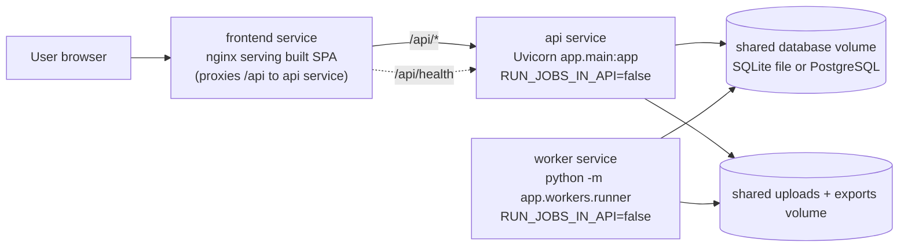

# Deployment

This document covers local development and the intended container topology. The repository is FastAPI + SQLAlchemy on the backend and a React/Vite SPA on the frontend; the database-backed job queue is executed either by an inline worker thread in the API process or by a separate worker process.

> Docker assets are present (`backend/Dockerfile`, `frontend/Dockerfile`, `docker-compose.yml`). The hosted portfolio demo uses **Vercel for the React UI** and **Render for the FastAPI API, inline worker and Postgres**. No external broker (Redis/Celery) exists in the code.

See [ARCHITECTURE.md](ARCHITECTURE.md) for component relationships, [DATABASE_SCHEMA.md](DATABASE_SCHEMA.md) for schema/bootstrap details, [SECURITY.md](SECURITY.md) for required hardening and [TESTING.md](TESTING.md) for verification commands.

## 1. Configuration reference

All settings are read from environment variables (or a `.env` file in the working directory) by `Settings` in `backend/app/core/config.py`.

| Variable | Default | Purpose |
| --- | --- | --- |
| `APP_NAME` | `SERPScope` | Application label |
| `ENVIRONMENT` | `development` | Reported by `/api/health` |
| `SECRET_KEY` | `dev-only-secret-change-before-deployment` | HMAC token signing **and** Fernet key derivation for integration credentials — override in every non-local environment |
| `DATABASE_URL` | `sqlite:///./data/serpscope.db` | SQLAlchemy URL; PostgreSQL URLs are supported by config (driver must be installed separately) |
| `UPLOAD_DIR` | `./data/uploads` | Uploaded imports, organised as `<project_id>/<timestamp>_<safe-name>` |
| `EXPORT_DIR` | `./data/exports` | Generated exports, served at `/api/v1/exports/files` |
| `ACCESS_TOKEN_EXPIRE_MINUTES` | `1440` | Bearer token lifetime (24 h) |
| `CORS_ORIGINS` | `http://localhost:5173,http://127.0.0.1:5173` | Comma-separated allowed origins (credentials enabled) |
| `JOB_POLL_SECONDS` | `0.5` | Worker idle poll interval |
| `RUN_JOBS_IN_API` | `true` | Start the inline worker daemon thread in the API process; set `false` when running the separate worker |
| `MAX_UPLOAD_MB` | `50` | Per-file upload limit |
| `LOG_LEVEL` | `INFO` | Root logging level used by `app.main` |

The frontend calls `/api/v1` by default, but `VITE_API_URL` can override it at build time (`frontend/src/lib/api.ts`). The hosted setup keeps the default and uses a Vercel rewrite to forward `/api` (including `/api/health` and `/api/v1/exports/files`) to the Render API, so the browser sees one origin and CORS is avoided.

## 2. Local development (two or three processes)

### Backend

```bash
cd backend
python -m venv .venv
# activate .venv (Windows: .venv\Scripts\activate)
pip install -r requirements.txt

# Optional overrides for local development
# export SECRET_KEY="a-local-random-value"
# export RUN_JOBS_IN_API=true

uvicorn app.main:app --reload --host 0.0.0.0 --port 8000
```

On startup the API:

1. Creates `UPLOAD_DIR` and `EXPORT_DIR`.
2. Runs `init_db()` → `Base.metadata.create_all()`, creating all 41 tables if absent.
3. If the `users` table is empty, creates the demo organisation `Demo Organisation` (`demo-organisation`) and owner `demo@serpscope.local` with password `demo1234`, plus an owner `Membership`.
4. Starts the inline worker thread if `RUN_JOBS_IN_API=true`.

Check with:

```bash
curl http://localhost:8000/api/health
# {"status":"ok","environment":"development","database":"sqlite"}
```

### Frontend

```bash
cd frontend
npm install
npm run dev        # Vite on http://localhost:5173, host 0.0.0.0
```

The Vite dev server must proxy `/api` to the Uvicorn port so the default `CORS_ORIGINS` and relative axios paths work. Alternatively, enable CORS for the frontend origin and call the API host directly during development.

### Separate worker (recommended for realistic job testing)

```bash
cd backend
export RUN_JOBS_IN_API=false
python -m app.workers.runner
```

The worker calls `init_db()`, imports all `*_jobs` handler modules, enqueues a `scheduler_tick` job roughly every 60 seconds, then polls the shared `jobs` table. Only **one** execution strategy should be active: either the inline thread or the standalone worker (running both is safe because claims are conditional updates, but it doubles polling and makes local debugging confusing).

## 3. Hosted portfolio demo: Vercel + Render

The checked-in infrastructure files are:

| File | Purpose |
| --- | --- |
| `vercel.json` | Builds `frontend/` with Vite, publishes `frontend/dist`, rewrites `/api/:path*` to `https://serpscope-api.onrender.com/api/:path*`, and falls back to `index.html` so SPA deep links work. |
| `render.yaml` | Render Blueprint declaring `serpscope-db` (Postgres), `serpscope-api` (FastAPI + inline job worker) and the production environment variables. |

Deploy sequence from the GitHub repository:

1. Create a **Blueprint** in Render pointing at the repository. It provisions `serpscope-db` and `serpscope-api`.
2. Render generates `SECRET_KEY` automatically and injects the database connection string.
3. After the first successful API deploy, `initialDeployHook` runs `python scripts/seed_demo.py --size 1000 --keyword-count 1000`, so the public demo has the same deterministic synthetic dataset used in screenshots and interview scenarios.
4. Import the repository into Vercel. It uses `vercel.json`, so no manual build settings are required. The canonical production URL is `https://serpscope.vercel.app`; legacy aliases redirect there in `vercel.json` once the canonical alias is attached to this project.
5. Confirm `https://serpscope.vercel.app/api/health` returns `{"status":"ok","environment":"production","database":"postgresql"}`. That proves the Vercel rewrite and Render API are connected and that no database credentials are exposed.
6. Log in with `demo@serpscope.local` / `demo1234`.
7. The Vercel project must allow public access to its production domain. In this deployment, Vercel Authentication (`ssoProtection`) was disabled on project `prj_096DxSK5ekfzYa4vHxEZ1YGbxwbb`; otherwise visitors see a `Protected by Vercel Authentication` page.

**Live deployment (verified 2026-11-22/23 on the project aliases; canonical URL configured):** UI and same-origin API are configured for `https://serpscope.vercel.app`, API/database on Render (`https://serpscope-api.onrender.com`), source on `https://github.com/bevijaygupta/serpscope`. The Render Blueprint ID is `exs-dc1iqeks728c73cic3l0`, API service ID `srv-dc1iqt2vcj2c73en3v8g`. Vercel auto-deploys from `main`; Render is connected through a public repository URL, so code changes need **Manual Deploy → Deploy latest commit** on the `serpscope-api` service (and Blueprint sync only when `render.yaml` changes). The canonical alias is currently assigned to another Vercel team; Vercel returns `serpscope.vercel.app is already assigned to another team. Use a different domain or transfer it.` Until that transfer completes, the configured canonical URL cannot be verified as the served production URL.

### 3.1 Publishing the real public audit on the hosted demo

The audit code was verified locally against a live domain, but the new endpoints are **not live until Render is manually deployed**. After pushing `main` and confirming the Vercel deployment:

1. In Render, open `serpscope-api` → **Manual Deploy → Deploy latest commit**; wait for the health check to pass.
2. Log in with `demo@serpscope.local` / `demo1234` and obtain a bearer token:
   ```bash
   curl -s -X POST https://serpscope-api.onrender.com/api/v1/auth/login \
     -H 'Content-Type: application/json' \
     -d '{"email":"demo@serpscope.local","password":"demo1234"}'
   ```
3. Publish project 2 (`https://www.techmagnate.com/`) as a case study:
   ```bash
   curl -X PATCH https://serpscope-api.onrender.com/api/v1/projects/2 \
     -H "Authorization: Bearer $TOKEN" -H 'Content-Type: application/json' \
     -d '{"settings":{"public_audit":true}}'
   ```
4. Queue the audit, poll `GET /api/v1/jobs/{job_id}` until `succeeded`, then check `GET /api/v1/audits/projects/2/public-audit`, all five export formats and `GET /api/v1/public/case-studies/2`.
5. Confirm the landing page at `https://serpscope.vercel.app`, `/robots.txt`, `/sitemap.xml`, `/llms.txt`, `/manifest.webmanifest`, `/favicon.svg`, `/og-preview.svg`, `/login` and `/overview`.

Local verification figures were 303 discovered URLs and 60 fetched from a deliberately narrow sample, with 60 sitemap entries from 9 documents and six finding groups. The completed hosted run (job 17, report 2, crawl 1) discovered 497 URLs, fetched 219, recorded 0 failures and 1 robots exclusion, and produced 12 finding groups plus a six-month roadmap. Its sitemap discovery timed out, so the hosted evidence states 0 sitemap entries rather than borrowing the local sample's 60. Neither figure is an exhaustive audit of the domain. Once the deploy and publish steps are done, the landing case study is available at `/api/v1/public/case-studies/2`.

Notes:

- The worker runs **inside the API process** (`RUN_JOBS_IN_API=true`) because Render background workers have no free plan. This is correct for a single-instance demo; use the separate `worker` service for a paid, production-like deployment.
- Free Render web services sleep after inactivity, so the first request may take about a minute. Free Postgres expires after 30 days; upgrade the database before relying on a long-lived demo.
- Uploads and exports use `/tmp/serpscope/...` because the free web service has no persistent disk. Generated files are not retained across restarts.
- If Vercel assigns a different project name, update `CORS_ORIGINS` on Render and the rewrite destination in `vercel.json`.
- PostgreSQL compatibility: keyword cannibalisation grouping is done in Python instead of SQLite's `GROUP_CONCAT`, and report queries order by column position to avoid Postgres `GROUP BY` ambiguity. The backend test suite passes in both local SQLite and hosted PostgreSQL configurations.

## 4. Intended container topology



| Service | Process | Notes |
| --- | --- | --- |
| `api` | `uvicorn app.main:app --host 0.0.0.0` | Mounts `/api/v1/exports/files` from `EXPORT_DIR`; exposes `/api/health`; should have `RUN_JOBS_IN_API=false` when a worker service is present |
| `worker` | `python -m app.workers.runner` | Same image and environment as `api`; no inbound port; shares the database (and upload/export directories for file-based jobs) |
| `frontend` (nginx) | Static SPA + reverse proxy | Serves the Vite `dist/` build, proxies `/api` and `/api/health` to `api`, so the browser only needs one origin |

Shared-state requirements:

- `api` and `worker` **must** point at the same `DATABASE_URL`. With SQLite this means a shared, writable volume and a single writer host; PostgreSQL is the safer multi-process choice.
- Both processes need the same `SECRET_KEY` (token verification and credential encryption) and the same `UPLOAD_DIR` / `EXPORT_DIR` paths so file-based import and export jobs can find files created by the API.
- Bind uploaded/exported directories to persistent volumes; otherwise generated reports and imported files are lost on container recreation.
- Set `CORS_ORIGINS` to the public frontend origin. When nginx proxies `/api` on the same origin, CORS is largely moot, but the default list must still be changed if the SPA is served from a different host/port.

Example environment block for both backend services (values are illustrative — generate your own secret):

```dotenv
ENVIRONMENT=production
SECRET_KEY=<generate-a-long-random-value>
DATABASE_URL=postgresql+psycopg://<user>:<password>@<host>:5432/<db>
RUN_JOBS_IN_API=false
CORS_ORIGINS=https://serpscope.example.com
ACCESS_TOKEN_EXPIRE_MINUTES=60
LOG_LEVEL=INFO
MAX_UPLOAD_MB=50
```

> `psycopg2-binary` is included in `backend/requirements.txt`. `Settings.normalise_database_url` converts a provider-supplied `postgres://` URL to `postgresql+psycopg2://`. SQLite needs no extra driver.

## 5. First run and verification

1. Start the database/volumes, then `api`, then `worker`, then `frontend`.
2. Confirm `GET /api/health` returns `{"status":"ok", ...}` through the same public origin as the SPA.
3. Log in at `/login` with an account created through `/api/v1/auth/register` (local) or provisioned in the database. Remove/rotate the seeded demo account for real deployments.
4. Queue a small job from the UI (e.g. "Add keyword" is synchronous; "Detect issues" is queued) and verify the job panel transitions to `succeeded`.
5. Run the backend test suite as described in [TESTING.md](TESTING.md) against a deployed-equivalent configuration where practical.

## 6. Operational notes

- **Schema changes:** run `alembic upgrade head` from `backend/` on each deploy. The baseline revision and `init_db()` both call `create_all()` for fresh tables; neither alters columns of an existing database. Any future change must ship as an explicit incremental revision and be tested against a copy of production data.
- **Backups:** back up the database and the upload/export volumes together. Integration credentials are Fernet-encrypted with a key derived from `SECRET_KEY`, so **losing or rotating `SECRET_KEY` makes stored credentials unreadable and invalidates all tokens**.
- **Retention:** `organizations.retention_days` exists (default 365) but no automated purge job was found in the code; retention must be handled operationally.
- **Job failures:** failed jobs persist `status="failed"`, an `error` string and `finished_at`; the traceback is returned at runtime but not stored. Monitor `jobs` with `status='failed'` or long-lived `status='claimed'`/`running'` rows (there is no visibility timeout or automatic retry).
- **Worker scheduler:** the `scheduler_tick` job is enqueued by the worker roughly every 60 seconds; ensure only one worker is running if you rely on scheduled workflows.

## 7. Production hardening checklist

Before exposing the stack publicly, address the items in [SECURITY.md](SECURITY.md#10-known-limitations--production-hardening-still-needed), in particular:

- [ ] Replace the default `SECRET_KEY` and store it in a secrets manager; plan rotation for tokens and Fernet credentials.
- [ ] Disable open self-registration and add SSO/admin provisioning; remove the automatic demo-account bootstrap.
- [ ] Restrict `CORS_ORIGINS`; terminate TLS at the edge; add rate limiting and login backoff.
- [ ] Use PostgreSQL with a managed pool instead of default SQLite for multi-process/concurrent writes.
- [ ] Add a backup/restore runbook and test each incremental Alembic revision against production-like data.
- [ ] Add network egress controls for the crawler (the code's SSRF check is string-based, not DNS-aware).
- [ ] Keep uploads non-executable and non-web-served; patch openpyxl/lxml/httpx dependencies.
- [ ] Replace the 300-character raw-error response with a generic 500 response and centralised logging.
